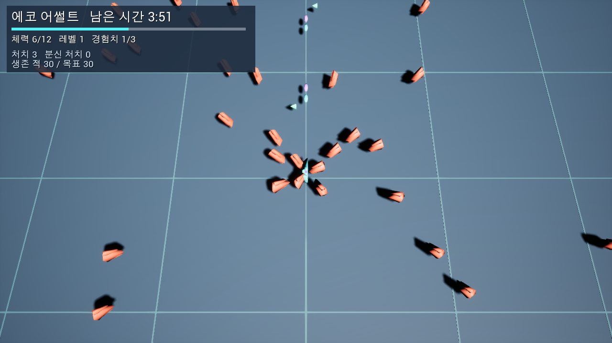
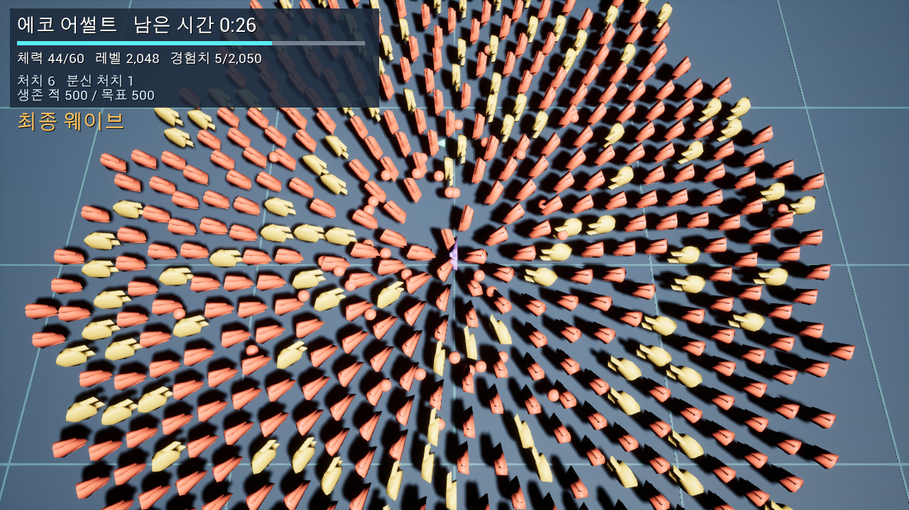

# Echo Assault

Unreal Engine 5.5 C++로 만든 4분 생존 액션 게임입니다. 플레이어의 과거 이동과 공격이 시간 잔상으로 돌아옵니다. 지금 그리는 동선이 몇 초 뒤 분신의 위치와 사격 방향을 결정합니다.

본 저장소는 포트폴리오 공개를 위해 정리한 최신 스냅샷입니다. 개발 중 사용한 로컬 Git 이력은 보안 정보와 개인정보 보호를 위해 제외했으며, 주요 검증 결과는 [`Docs/Evidence`](Docs/Evidence/README.md)에 별도로 정리했습니다.

## 게임 화면

| 아레나 전투와 첫 분신 | 최종 웨이브 검증에서 생존 적 500마리 |
| --- | --- |
|  |  |

### 시연 영상

촬영 후 이곳에 시연 영상 링크를 추가합니다.

## 핵심 시스템

- **시간 잔상** — 최대 3기가 기본 8·16·24초 지연으로 이동과 공격을 재현합니다. 발사 시각·원점·방향·무기·당시 강화 단계를 기록하고 살아 있는 적과의 충돌은 현재 월드에서 판정합니다.
- **전투와 성장** — 블래스터·유도탄·방사형 칼날과 플레이어 전용 분해장이 있습니다. 초기 웨이브부터 동시 생존 적 목표를 단계적으로 올려, 3:30 최종 웨이브에는 500마리를 목표로 보충합니다.
- **탄환 표시** — 탄환 Actor가 이동과 구체 충돌을 담당합니다. 메시와 색이 같은 탄환은 ISM에 모으고, 프레임마다 그룹 단위로 위치를 갱신합니다.

[시스템 설계](Docs/Design.md) · [시간 잔상 재생](https://github.com/tjwjdah/EchoAssault/blob/f0af1f81c45122c16d291f97ee0716a4bd4b9fce/Source/EchoAssault/EchoGame.cpp#L556) · [탄환 ISM 일괄 갱신](https://github.com/tjwjdah/EchoAssault/blob/f0af1f81c45122c16d291f97ee0716a4bd4b9fce/Source/EchoAssault/EchoGame.cpp#L787) · [강화창 입력 초기화](https://github.com/tjwjdah/EchoAssault/blob/f0af1f81c45122c16d291f97ee0716a4bd4b9fce/Source/EchoAssault/EchoInterface.cpp#L72)

## AI 협업과 개발 하네스

개발 맥락은 [작업 규칙](AGENTS.md), [설계](Docs/Design.md), [진행과 검증 기록](Docs/Status.md)에 남겼습니다. Codex가 작업 규칙과 현재 상태를 읽고 구현·빌드·검사를 수행한 뒤 결과를 상태 문서에 기록하는 흐름입니다. 실행 단계는 [Verify.ps1](Tools/Verify.ps1)이 묶고, 성능 측정과 판정에는 [PerfCheck.ps1](Tools/PerfCheck.ps1)과 [QA 스킬](.agents/skills/echo-performance-qa/SKILL.md)을 사용했습니다.

| 담당 | 실제 작업 |
| --- | --- |
| 개발자 | 시간 잔상의 플레이 기준과 성능 시나리오 설정, C++ 분해장·탄환 ISM 일괄 갱신·강화창 입력 버그 수정, 직접 플레이와 Unreal Insights 구간 확인 |
| Codex | 게임 기반 구현 지원, 빌드·리플레이·성능 검증 자동화, 회귀 테스트 구현, 계측 원본 재집계와 검증 기록 정리 |

개발자가 강화 전후의 공격이 분신에서 어떤 단계로 재생되어야 하는지 짚었습니다. Codex는 이를 [회귀 테스트](https://github.com/tjwjdah/EchoAssault/blob/f0af1f81c45122c16d291f97ee0716a4bd4b9fce/Source/EchoAssault/EchoGameplayTests.cpp#L478)로 구현했습니다. 같은 칼날 무기의 1단계 공격 6발과 2단계 공격 8발을 각각 기록하고, 첫 분신이 18초와 21초에 해당 공격을 중복 없이 재생하는지 확인합니다. 새 Codex 세션에는 기존 대화 없이 문서와 실행 근거를 전달했습니다. [인수인계와 QA 세 사례](Docs/Status.md#인수인계와-qa-사례)

## 성능 분석

| 1080p 자동 전투 | p95 프레임 시간 중앙값 | 16.67 ms 예산 초과 |
| --- | ---: | ---: |
| 이동 3회 | 13.42 ms | 1 / 5,400 |
| 정지 3회 | 13.57 ms | 2 / 5,400 |

시작 적 500마리 중 100마리를 원거리 적으로 설정해 적 탄환도 부하에 포함했습니다. 세 분신의 공격 재생 이후 30초 구간을 측정했습니다. 이동과 정지의 적 밀집·충돌 양상이 다를 수 있어 따로 반복했습니다. 수치는 i9-12900KF·RTX 3050의 DX12 오프스크린 Development 실행에서 나온 값입니다. [프레임 원본 발췌](Docs/Evidence/PerfCheck-Frames.csv) · [회차별 집계](Docs/Evidence/PerfCheck-Summary.json)

별도의 Unreal Insights A/B 측정에서 160발/초 첫 쌍 360표본의 **탄환 위치 적용 구간** 평균은 개별 호출 0.349 ms에서 일괄 호출 0.026 ms로 줄었습니다. 같은 구간을 포함한 테스트 전체 CPU 범위는 2.534 ms에서 2.216 ms로 줄었습니다. [A/B 실험 범위와 원본 발췌](Docs/Evidence/README.md#탄환-ism-격리-측정)

## 실행과 검증

### Windows 실행 파일

ZIP 전체를 푼 뒤 폴더 맨 위의 `EchoAssault.exe`를 실행합니다. [Windows 64비트 ZIP 다운로드](https://github.com/tjwjdah/EchoAssault/releases/download/portfolio-win64/EchoAssault-Win64.zip) · [배포 안내](https://github.com/tjwjdah/EchoAssault/releases/tag/portfolio-win64)

### 소스에서 빌드와 검증

Windows, Unreal Engine 5.5.3, Visual Studio 2022 C++ 빌드 도구와 Windows SDK가 필요합니다. 저장소 루트에서 `FirstPlay.cmd`를 실행하면 Editor 빌드, 네이티브 리플레이 검사, Unreal 자동 테스트를 거쳐 게임 창을 엽니다. 첫 빌드에는 시간이 걸립니다.

WASD로 이동하고 마우스로 조준합니다. 공격은 자동입니다. 경험치 결정체를 모아 강화 셋 중 하나를 선택하고, 최종 웨이브를 지나 4:00까지 생존하면 승리합니다.

| 작업 | 저장소 루트의 PowerShell에서 실행 |
| --- | --- |
| Editor 빌드와 자동 검증 | `powershell.exe -NoProfile -ExecutionPolicy Bypass -File .\Tools\Verify.ps1` |
| Win64 Development 게임 타깃 컴파일 | `powershell.exe -NoProfile -ExecutionPolicy Bypass -File .\Tools\Build.ps1 -Game` |
| 1080p 패키지 성능 측정 | `powershell.exe -NoProfile -ExecutionPolicy Bypass -File .\Tools\PerfCheck.ps1` |

별도 위치에 UE를 설치했다면 PowerShell 스크립트에 `-EngineRoot`로 엔진 루트를 넘깁니다. 전체 검증 전에는 프로젝트 에디터와 게임을 닫습니다. 자동 검증 증거는 실행 후 `Saved/TestReports`와 `Saved/Logs`에 생성됩니다. `Build.ps1 -Game`은 C++ 타깃을 컴파일합니다. 실행 가능한 별도 배포본을 만들 때는 에디터의 Windows 패키징으로 콘텐츠도 쿠킹합니다.

성능 측정에는 유효한 커밋이 있는 Git 체크아웃과 Python 3가 추가로 필요합니다. [측정 조건과 확인 방법](Docs/Evidence/README.md)을 참고하세요.

## 저장소 구성

| 경로 | 역할 |
| --- | --- |
| `EchoAssault.uproject`, `Source/`, `Config/` | UE 프로젝트, C++ 게임 및 테스트, 기본 설정 |
| `Content/Echo/`, `ArtSource/` | 아레나와 임포트된 메시, 재생성 가능한 OBJ 원본 |
| `Tools/`, `FirstPlay.cmd` | 실행, 에셋 생성, 빌드·자동 검증·성능 측정 |
| `Docs/`, `AGENTS.md`, `.agents/skills/` | 설계와 인수인계, 검증 수치의 근거와 QA 절차 |
